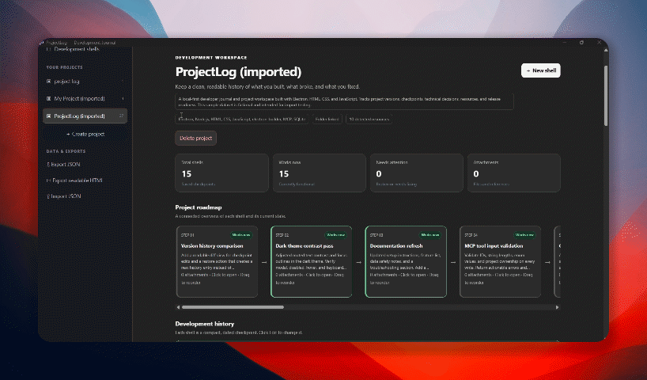

# ProjectLog

**A desktop workspace to document, organize, and track your software projects.**

ProjectLog is a desktop application built with Electron, HTML, CSS, and JavaScript. It provides a dedicated space to maintain project notes, track development progress, organize resources, and keep important project information accessible in one place.


<p align="center">
  
</p>


## Features

- **Project Management** — Create and maintain project records in one workspace.
- **Development Journal** — Document progress, ideas, decisions, and implementation notes.
- **Roadmap & Tracking** — Organize project plans and monitor development milestones.
- **Search** — Quickly locate projects and relevant information.
- **Markdown Support** — Write structured notes with readable formatting.
- **History** — Keep track of project changes and previous work.
- **Media & Attachments** — Work with project-related media and supporting resources.
- **Folder Scanner** — Scan a selected project directory and generate a readable file tree.
- **Resource Discovery** — Identify supported files, including source code, documents, images, datasets, and model files.
- **PDF Export** — Export project reports as PDF documents.
- **Import & Export** — Preserve project data using the application's supported data interchange format.
- **Collapsible Sidebar** — Keep the interface clean and maximize workspace.
- **External Links** — Open GitHub and portfolio links in the system's default browser.
- **Desktop Experience** — Run as a standalone Electron application on Windows.

> Feature availability may depend on the version of ProjectLog you are using.
## Download ProjectLog

Get ProjectLog for Windows from the GitHub Releases page.

[**Download ProjectLog for Windows**](https://github.com/sakib-12345/ProjectLog/releases/latest)

1. Open the latest release.
2. Download the `.exe` installer from the **Assets** section.
3. Run the installer and follow the setup instructions.
4. Launch ProjectLog from the Start menu or desktop shortcut, if created.

**System requirements**
- Windows 10 or Windows 11
- No separate Node.js installation required for the packaged application


## Tech Stack

| Technology       | Purpose                                              |
| ---------------- | ---------------------------------------------------- |
| Electron         | Desktop application framework                        |
| HTML5            | Application structure                                |
| CSS3             | Styling and responsive interface                     |
| JavaScript       | Application logic and interactions                   |
| Node.js          | Desktop-side operations                              |
| Electron IPC     | Communication between the interface and main process |
| Electron Builder | Application packaging and distribution               |


## Getting Started

### Prerequisites

- Windows 10 or Windows 11
- [Node.js](https://nodejs.org/) with npm
- Git (optional, for cloning the repository)

### 1. Clone the repository

```bash
git clone https://github.com/sakib-12345/ProjectLog.git
```

### 2. Open the project directory

```bash
cd ProjectLog
```

### 3. Install dependencies

```bash
npm install
```

### 4. Start ProjectLog

```bash
npm start
```

The Electron desktop application should launch.

## Build for Windows

ProjectLog uses Electron Builder to package the application.

Run:

```bash
npm run dist
```

After the build finishes, check the generated `dist/` directory for the packaged application and installer artifacts.

The exact output depends on your `package.json` and Electron Builder configuration.

## Project Structure

```text
ProjectLog/
├── assets/
│   └── icon.png
├── main.js
├── preload.js
├── index.html
├── package.json
├── package-lock.json
└── README.md
```

- `main.js` — Creates the application window, handles desktop operations, scans folders, and exports PDF reports.
- `preload.js` — Exposes approved desktop functionality to the renderer through a controlled bridge.
- `index.html` — Contains the application's interface and frontend logic.
- `assets/` — Stores application assets such as the icon.
- `package.json` — Defines dependencies, scripts, and build configuration.

## Folder Scanner

The folder scanner helps you understand a software project's structure without manually browsing every directory.

It can:

- Generate a hierarchical file tree.
- Identify supported resource types.
- Display file metadata, including file size and modification time.
- Skip common generated or dependency directories.
- Limit scanning to 500 entries and a depth of five levels to control resource usage.

Common excluded directories include `node_modules`, `.git`, `.venv`, `build`, `dist`, and `__pycache__`.

## PDF Export

ProjectLog can generate PDF reports from project content.

The desktop process handles the save dialog, renders the report, and writes the resulting PDF to the selected location.

## Security

ProjectLog uses Electron's security-related configuration options, including:

- `contextIsolation: true`
- `nodeIntegration: false`
- `sandbox: true`

Desktop operations should be exposed to the frontend through a restricted preload bridge. External HTTP and HTTPS links are intended to open in the operating system's default browser.

## Development

Start the application in development mode:

```bash
npm start
```

Build a distributable package:

```bash
npm run dist
```

If you modify the application, test the affected features before creating a release.

## Roadmap

Potential areas for future development:

- [ ] Enhanced project roadmaps and milestone tracking
- [ ] More powerful search and filtering
- [ ] Improved Markdown editing and preview
- [ ] Project revision history
- [ ] Better media and attachment management
- [ ] More export formats and customizable reports
- [ ] Improved application settings and keyboard shortcuts
- [ ] Automated release builds and update support

## Contributing

Contributions, bug reports, and feature suggestions are welcome.

1. Fork the repository.
2. Create a feature branch.
3. Make your changes.
4. Test the affected functionality.
5. Open a pull request describing your changes.

Please keep changes focused and preserve compatibility with existing project data and supported import/export formats.

## License

This project is licensed under the MIT License if the repository includes an MIT license file. See `LICENSE` for the applicable terms.

## Author

**Shakib Hossain Tahmid**

- GitHub: [@sakib-12345](https://github.com/sakib-12345)
- Portfolio: [shakibhossaintahmid.vercel.app](https://shakibhossaintahmid.vercel.app)

---

*ProjectLog — Keep your projects organized. Keep your progress documented.*
